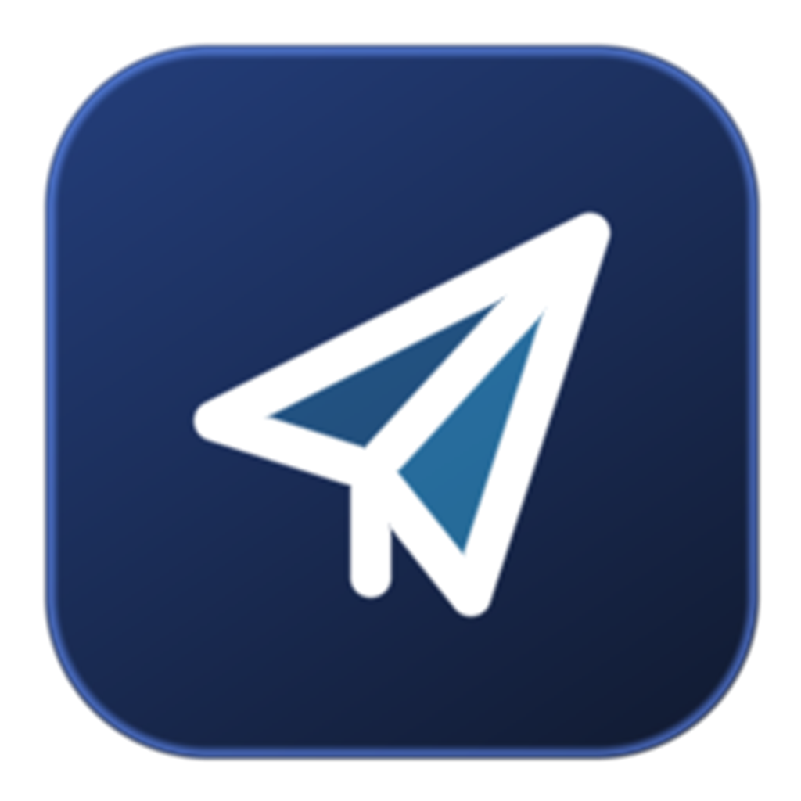
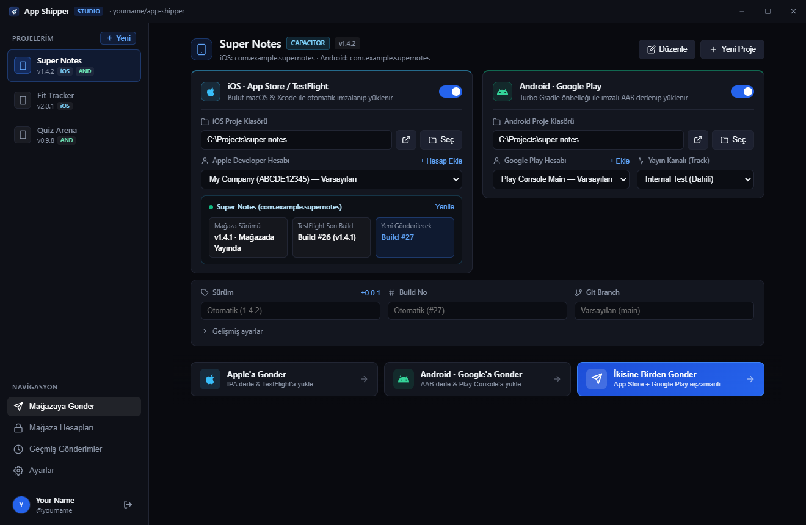
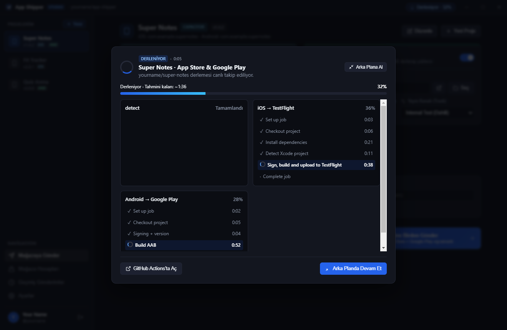
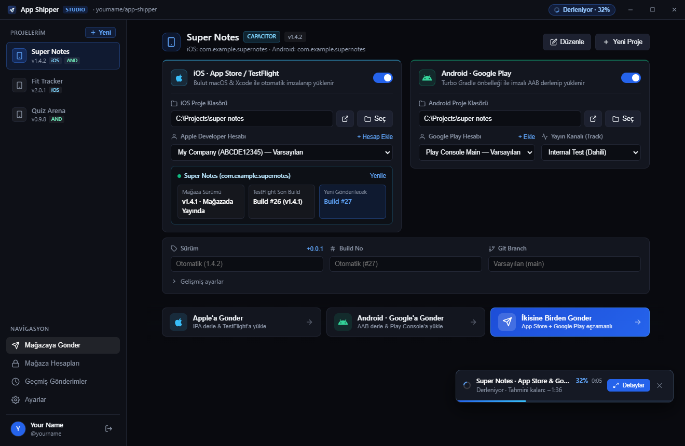
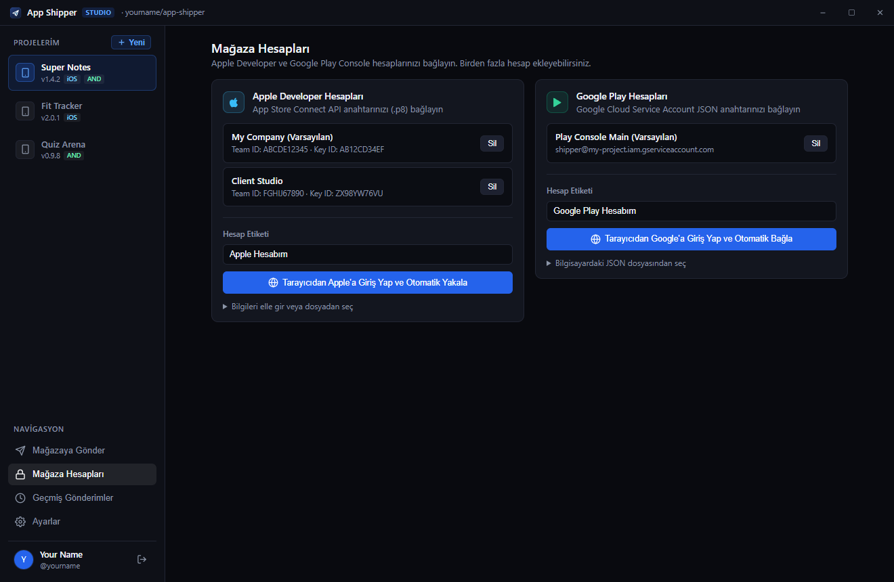
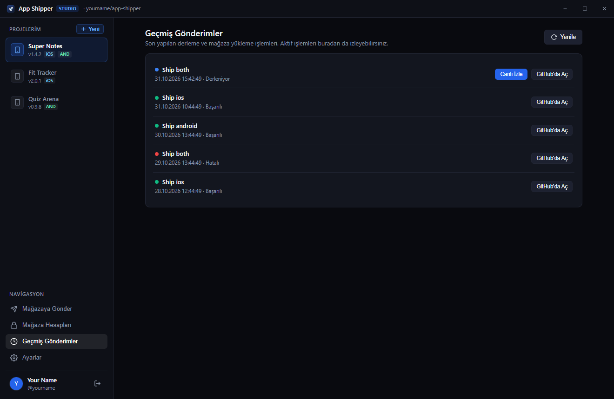
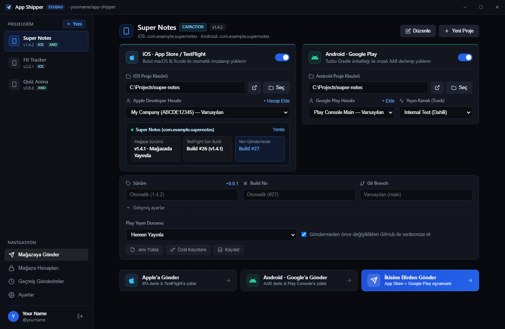
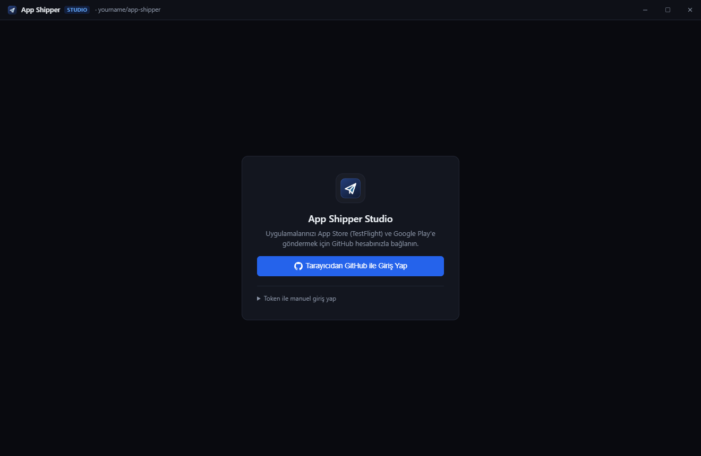

<div align="center">



# App Shipper Studio

**Ship your mobile app to TestFlight and Google Play with one click. No Mac required.**
**Mobil uygulamanı tek tıkla TestFlight ve Google Play'e gönder. Mac gerekmez.**

[English](#-english) · [Türkçe](#-türkçe)

</div>

<p align="center">
  <a href="../../releases/latest"></a>
  <a href="LICENSE"></a>
  
  
  <a href="../../stargazers"></a>
</p>

---

# 🇬🇧 English

## Contents
- [What is it?](#what-is-it)
- [Features](#features)
- [Screenshots](#screenshots)
- [How it works](#how-it-works)
- [Quick start (Desktop app)](#quick-start-desktop-app)
- [Connecting your accounts](#connecting-your-accounts)
- [Shipping an app](#shipping-an-app)
- [Versions & build numbers](#versions--build-numbers)
- [Speed](#speed)
- [Command line (`ship`)](#command-line-ship)
- [Project config: `ship.json`](#project-config-shipjson)
- [Security & privacy](#security--privacy)
- [Troubleshooting](#troubleshooting)
- [Building the desktop app yourself](#building-the-desktop-app-yourself)
- [FAQ](#faq)

## What is it?
App Shipper builds, signs and uploads your app in the cloud using **GitHub Actions** (macOS runner for iOS, Linux runner for Android). Your computer can be off, you can be on **Windows**, and there is no Expo/EAS queue.

Supported project types (detected automatically): **Capacitor**, **Expo / React Native**, **Flutter**, **native Android & iOS**.

```
You ──► App Shipper Studio ──► GitHub Actions (your own copy of this repo)
                                 ├─ Android: build AAB → sign → Google Play
                                 └─ iOS:     archive → sign → TestFlight
```

## Features
- **Desktop app for Windows & macOS** (installer + portable `.exe`), plus a CLI.
- **Saved projects**: pick the folder once, ship forever. iOS and Android can live in separate folders, or turn a platform off.
- **Multiple accounts**: several Apple Developer and Google Play profiles, choose per project.
- **Browser sign-in**: log in to GitHub, Apple and Google from your browser; the app captures the keys for you.
- **Live store status**: shows the current App Store version and the last TestFlight build, and picks the next build number automatically.
- **Background shipping**: minimize a running build into a small progress bar, keep working, get a desktop notification when it finishes.
- **Automatic signing**: Apple Distribution certificate, provisioning profile and Android upload keystore are created and managed for you.
- **Per-project `.env` and custom keystore** support.
- **Git auto-sync**: uncommitted changes are committed and pushed before shipping (can be turned off).

## Screenshots
_The interface is currently in Turkish. Screenshots use demo data._

<p align="center">
  
</p>
<p align="center"><em>Project workspace: accounts, live App Store status, version/build and the sticky send bar</em></p>

<table>
  <tr>
    <td width="50%"><br /><sub>Live build progress with per-step status and time left</sub></td>
    <td width="50%"><br /><sub>Background mode: a small progress bar plus a pill in the title bar</sub></td>
  </tr>
  <tr>
    <td width="50%"><br /><sub>Multiple Apple Developer and Google Play accounts</sub></td>
    <td width="50%"><br /><sub>Shipping history with live status</sub></td>
  </tr>
  <tr>
    <td width="50%"><br /><sub>Advanced settings: publish mode, git sync, .env, custom keystore</sub></td>
    <td width="50%"><br /><sub>One-click GitHub sign-in from the browser</sub></td>
  </tr>
</table>

## How it works
1. The desktop app pushes your project to GitHub (or uses the repo it already has).
2. It triggers the `ship.yml` workflow in **your** app-shipper repo.
3. GitHub builds on a fresh runner, signs with the secrets you stored, and uploads to the stores.
4. The app polls the run and shows live steps, percentage and estimated time left.

## Quick start (Desktop app)

### Requirements
| Need | Why |
|---|---|
| A **GitHub account** | Builds run automatically on your own GitHub Actions |
| **Git** (standard on macOS / Git for Windows) | Used to sync your mobile project folder |
| An **Apple Developer** account ($99/yr) for iOS | TestFlight |
| A **Google Play Console** account ($25 once) for Android | Google Play |

*(No extra CLI tools, Node.js, Homebrew, or Java JDK installation is required — App Shipper Studio handles everything internally.)*

### Option A: Install the Desktop App (Recommended — Zero Setup)

#### 🪟 Windows (10 / 11 — x64)
1. Download **`App Shipper Studio Setup 1.1.0.exe`** (installer) or **`App Shipper Studio 1.1.0.exe`** (portable, no install needed) from [Releases](../../releases/latest).
2. If Windows SmartScreen appears on first launch, click **More info → Run anyway**.
3. Open the app and click **Tarayıcıdan GitHub ile Giriş Yap** (*Sign in with GitHub in browser*). Your own `YourUsername/app-shipper` build repo is created and configured automatically!

#### 🍎 macOS — Apple Silicon (`M1 / M2 / M3 / M4`) & Intel (`x64`)
1. Download the `.dmg` for your Mac from [Releases](../../releases/latest):
   - **Apple Silicon (`M1 / M2 / M3 / M4`):** **`App Shipper Studio-1.1.0-arm64.dmg`**
   - **Intel Mac (`x64`):** **`App Shipper Studio-1.1.0.dmg`**
2. Open the `.dmg` file and drag **App Shipper Studio** into your **Applications** folder (just like any standard Mac app — no Terminal or Homebrew required).
3. **First Launch (macOS Gatekeeper):** Because the app is ad-hoc signed without an Apple notarization certificate, the first time you open it:
   - **Right-click (or Control-click) `App Shipper Studio` in Applications → click `Open`**, or
   - Go to **System Settings → Privacy & Security → click `Open Anyway`**.
4. Click **Tarayıcıdan GitHub ile Giriş Yap** (*Sign in with GitHub in browser*).

### Option B: Run from Source (For Developers)
```bash
git clone https://github.com/OsmanSivrikaya/app-shipper.git
cd app-shipper
npm install
npm start
```

### How to Use the Desktop App (Step-by-Step)
The desktop interface is organized into **4 main tabs** on the left sidebar:

1. **Projelerim (Workspace & Projects):**
   - Click **+ Yeni** in the left sidebar to register a mobile project. Give it a name, enable **iOS** and/or **Android**, and pick your project folder (single folder for Flutter/Capacitor/React Native, or two separate folders if iOS & Android live in different repositories).
   - **Mağaza Hesapları & Kanal:** Pick which Apple Developer profile and Google Play profile to use for this project, plus the Google Play track (`Internal`, `Alpha`, `Beta`, `Production`).
   - **Canlı Mağaza Durumu (Live Store Status):** For iOS projects, the blue status bar automatically queries App Store Connect in real time and shows the live store version (`Yayındaki Sürüm`), the latest TestFlight build number, and the **next build number** (`Sıradaki Build`) that will be assigned automatically.
   - **Sürüm & Build & Branch:** Override the marketing version (or click **`+0.0.1`** to bump the patch version), force a custom build number, or specify a Git branch/tag.
   - **Gelişmiş Ayarlar (Advanced):** Expand to choose *Hemen Yayınla* (`completed`) vs *Taslak* (`draft`), toggle automatic Git commit+push before shipping, upload a project-specific `.env` file, or attach a custom `.jks` Android keystore.
   - **Gönderim Çubuğu (Sticky Send Bar):** Click **Apple'a Gönder** (iOS only), **Android · Google'a Gönder** (Android only), or **İkisine Birden Gönder** (both in parallel).
2. **Canlı Derleme & Arka Plan Modu (Live Build & Background Bar):**
   - While building, a live modal shows only the selected platform(s), step-by-step progress, elapsed time, and estimated time remaining.
   - Click **Arka Plana Al** (*Run in background*) to minimize the build into a compact floating bar at the bottom-right so you can switch projects or edit settings while it builds.
   - Click **Derlemeyi Durdur** (*Stop Build*) at any time to cancel the running GitHub Actions job immediately.
3. **Mağaza Hesapları (Store Accounts):**
   - Add and manage multiple **Apple Developer (App Store Connect)** and **Google Play Console** profiles. Use the one-click browser capture buttons or select your `.p8` / `.json` files manually.
4. **Geçmiş Gönderimler (Shipping History):**
   - View up to 100 past builds with **Project**, **Platform (`iOS`, `Android`, `Both`)**, **Status (`Başarılı`, `Hatalı`, `Derleniyor`, `İptal Edildi`)**, and **Date Range (`Bugün`, `Son 7 Gün`, `Son 30 Gün`)** filters, **Sorting** (by newest/oldest date, project name, or build duration), keyword search, and **Pagination**.
   - Watch or cancel currently running builds directly from the history list.
5. **Ayarlar (Settings):**
   - Set your central GitHub build repository (`YourUsername/app-shipper`) and optional `SOURCE_TOKEN`.

### Automatic Per-User GitHub Actions Isolation
When you sign in with GitHub, the app automatically creates a public **`YourUsername/app-shipper`** repository on **your own GitHub account** and syncs the build workflow there. All your signing secrets and GitHub Actions runs stay 100% in your own GitHub account.

## Connecting your accounts

### GitHub
Press **Sign in with GitHub in browser**, copy the one-time code shown in the app, approve in the browser. Manual alternative: paste a token with `repo` and `workflow` scopes.

### Apple (TestFlight)
1. **Accounts → Apple → Sign in to Apple in browser and capture automatically.**
2. In the opened App Store Connect page go to **Users and Access → Integrations → App Store Connect API → Team Keys → +** (role **Admin**) and **download the `.p8`**. The app captures the file, Key ID and Issuer ID.
3. The app creates an **Apple Distribution certificate** for you and reads your real **Team ID** from it (you never type it).
4. **Create your app once** in App Store Connect (Apps → +) with the same Bundle ID as your project. The API cannot create the store record.

> Apple allows only a few Distribution certificates per team. If you hit the limit, revoke an unused one at developer.apple.com → Certificates.

### Google Play
1. **Accounts → Google Play → Sign in to Google in browser and connect automatically.**
2. Create a **Service Account** in Google Cloud, enable **Google Play Android Developer API**, add a **JSON key**; the app captures the downloaded file.
3. In [Play Console](https://play.google.com/console) → **Users and permissions** → invite the service-account e-mail and grant **Release manager** (at least Internal testing) for your app.
4. **Create the app in Play Console and upload the first AAB manually once** (internal testing). The API cannot upload to an app that has no release.
5. A shared **upload keystore** is generated automatically. If you already uploaded with another key, add it under **Project → Advanced → Custom Keystore (.jks)**.

## Shipping an app
1. **Projects → New**: name, tick iOS and/or Android, choose the folder(s). One folder for Flutter/Capacitor/RN; separate folders if your iOS and Android projects are separate.
2. Pick the Apple / Google account and the Android **track** (Internal, Alpha, Beta, Production).
3. Optional: set **Version**, **Build No**, **Git Branch**; under **Advanced** choose *Publish now* vs *Draft*, add `.env`, add a custom keystore.
4. Press **Send to Apple**, **Send to Google** or **Send to both** (sticky bar at the bottom).
5. **Run in background** shrinks the progress window into a bar at the bottom-right and a pill in the title bar. Click it to reopen details. You get a notification when done.

## Versions & build numbers
- **Version (marketing)**: leave empty to keep what is in your project. Use `+0.0.1` to bump. Enter `1.2.0+45` to also force build number `45`.
- **iOS build number**: the last TestFlight build **+1**, queried live from App Store Connect (never collides).
- **Android versionCode**: auto-generated, always increasing, `YYDDDHHMM` (UTC), e.g. `262971512`. Two ships in the same minute collide; wait a minute.
- If App Store already released that version number, enter a higher **Version**.

## Speed
Measured on a real iOS run, most time was not compiling. What is already optimized:
- iOS and Android build **in parallel**.
- npm, Gradle, SwiftPM, CocoaPods and DerivedData are **cached and refreshed on every run**; the first run is slow, later runs are fast.
- Project detection uses **one** Xcode query without Swift package resolution (was ~100 s).
- Missing secrets are checked **before** the build, so you fail in seconds, not minutes.
- Ship only what you need (single platform buttons).

Typical times after the cache is warm: Android 3–4 min, iOS 2–5 min.

## Command line (`ship`)
```bash
npm link                 # adds `ship` to your terminal
ship setup               # wizard: repo + all secrets
ship doctor              # lists what is missing
```
```bash
ship                              # repo in current folder → iOS + Android
ship my-app                       # YourName/my-app
ship my-app ios                   # TestFlight only
ship my-app android               # Google Play only
ship my-app --version 1.2.0       # marketing version
ship my-app --ref develop         # branch / tag / sha
ship my-app android --track beta  # internal (default) | alpha | beta | production
ship my-app android --draft       # leave as draft in Play
ship my-app --no-watch            # trigger and exit
ship status                       # last 15 runs
```
Automatic shipping on every git tag:
```bash
ship init my-app                  # once: adds ship-on-tag.yml to the repo
git tag v1.0.5 && git push --tags # TestFlight + Google Play
```
Per-project settings:
| Command | Does |
|---|---|
| `ship keystore <repo> --jks k.jks --alias upload --store-pass PASS` | App-specific Android keystore |
| `ship env <repo> .env.production` | Variables written to `.env` during the build |
| `ship play key.json` | Upload/refresh the Google Play service-account key |

## Project config: `ship.json`
Auto-detection is usually enough. Otherwise put this in your project root (all fields optional):
```json
{
  "appPath": "frontend",
  "prepare": "npm run build",
  "android": { "dir": "android", "task": "bundleRelease" },
  "ios": { "dir": "ios/App", "scheme": "App" }
}
```

## Security & privacy
- Keys live **only** in GitHub Secrets of the repo you chose, and in `~/.app-shipper` on your computer (certificate, `.p8`, config). Nothing is sent to any other server.
- The desktop app never uploads keys anywhere except GitHub Secrets (encrypted by GitHub).
- A public build repo is safe: secrets are not readable by forks or pull requests and are masked in logs. **Never commit `.p8`, `.p12`, `.jks`, `.env` or tokens.** `~/.app-shipper` is outside the repo.
- Treat your GitHub token and `~/.app-shipper` like passwords.
- Private source repos work: a token with access to them is stored as `SOURCE_TOKEN`.

## Troubleshooting
| Problem | Cause → Fix |
|---|---|
| `No profile for team … matching …` (iOS) | Wrong Team ID. Fixed automatically: it is read from the certificate. Re-save the Apple account once. |
| `App Store Connect'te '…' uygulama kaydı yok` / app record not found | Create the app in App Store Connect once with the same Bundle ID |
| `Apple Distribution sertifika limiti dolu` | Revoke an unused Distribution certificate on developer.apple.com |
| Play: `The caller does not have permission` | Grant the service account access to the app in Play Console |
| Play: `Package not found` | Create the app and upload the first AAB manually once |
| Play: `Upload key mismatch` | Use your old keystore: Advanced → Custom Keystore |
| `versionCode already used` | Two ships in the same minute; wait and retry |
| `Run was not started` / `action_required` | Needs a public repo or fixed billing; use a public fork |
| `The job was not started because recent account payments have failed` | Private repo billing. Make the fork public (free minutes) |
| `***` in logs | GitHub masks secret values (e.g. the word `upload`). Not an error |
| Windows SmartScreen warning | App is unsigned. **More info → Run anyway** |
| OpenSSL not found | Install Git for Windows (includes OpenSSL) |
| `keytool` not found | Install a JDK or choose your own `.jks` |

Get the log of a failed run:
```bash
gh run view <id> --repo YourName/app-shipper --log-failed
```

## Building the desktop app yourself
```bash
npm install
npm start                    # run directly in Electron
npm run dist:win             # Windows: Setup .exe + Portable .exe
npm run dist:mac             # macOS: builds both Apple Silicon (arm64) & Intel (x64) .dmg + .zip
npm run dist:mac:silicon     # macOS Apple Silicon (M1 / M2 / M3 / M4) only
npm run dist:mac:intel       # macOS Intel (x64) only
npm run dist:mac:universal   # macOS Universal binary (arm64 + x64 in a single .dmg)
```
On Windows, if `electron-builder` fails extracting `winCodeSign` (symlink error), enable **Developer Mode** or run the terminal as administrator, and set `CSC_IDENTITY_AUTO_DISCOVERY=false` to skip signing.

## FAQ
**Do I need a Mac?** No. iOS is built on GitHub's macOS runners.
**Is it free?** The tool is. GitHub Actions is free and unlimited on public repos; private repos use your monthly quota (macOS minutes cost 10×). Apple ($99/yr) and Google ($25 once) fees still apply.
**Can I use several Apple/Google accounts?** Yes, add as many profiles as you like and pick one per project.
**Is my code public?** No. Only the build repo (a fork of this tool) is public; your app code stays in your own repos.
**Which Xcode/Java/Node versions?** Latest stable Xcode; Java 17/21 and Node picked from your project (`.nvmrc`, `engines`, Gradle version).

---

# 🇹🇷 Türkçe

## İçindekiler
- [Nedir?](#nedir)
- [Özellikler](#özellikler)
- [Ekran görüntüleri](#ekran-görüntüleri)
- [Nasıl çalışır?](#nasıl-çalışır)
- [Hızlı başlangıç (Masaüstü uygulaması)](#hızlı-başlangıç-masaüstü-uygulaması)
- [Hesapları bağlama](#hesapları-bağlama)
- [Uygulama gönderme](#uygulama-gönderme)
- [Sürüm ve build numarası](#sürüm-ve-build-numarası)
- [Hız](#hız)
- [Komut satırı (`ship`)](#komut-satırı-ship)
- [Proje ayarı: `ship.json`](#proje-ayarı-shipjson)
- [Güvenlik ve gizlilik](#güvenlik-ve-gizlilik)
- [Sorun giderme](#sorun-giderme)
- [Masaüstü uygulamasını kendin derle](#masaüstü-uygulamasını-kendin-derle)
- [Sık sorulanlar](#sık-sorulanlar)

## Nedir?
App Shipper, uygulamanı **GitHub Actions** üzerinde (iOS için macOS, Android için Linux sunucusu) derler, imzalar ve mağazaya yükler. Bilgisayarın kapalı olabilir, **Windows** kullanabilirsin, Expo/EAS kuyruğu yoktur.

Desteklenen proje tipleri (otomatik bulunur): **Capacitor**, **Expo / React Native**, **Flutter**, **native Android ve iOS**.

```
Sen ──► App Shipper Studio ──► GitHub Actions (bu reponun kendi kopyan)
                                 ├─ Android: AAB derle → imzala → Google Play
                                 └─ iOS:     archive → imzala → TestFlight
```

## Özellikler
- **Windows ve macOS masaüstü uygulaması** (kurulum + taşınabilir `.exe`) ve komut satırı aracı.
- **Kayıtlı projeler**: klasörü bir kez seç, sonra hep tek tıkla gönder. iOS ve Android farklı klasörde olabilir ya da bir platformu kapatabilirsin.
- **Çoklu hesap**: birden fazla Apple Developer ve Google Play profili, proje başına seçilir.
- **Tarayıcıdan giriş**: GitHub, Apple ve Google'a tarayıcıdan giriş yap, uygulama anahtarları kendisi yakalar.
- **Canlı mağaza bilgisi**: App Store'daki sürümü ve son TestFlight build'ini gösterir, sıradaki build numarasını otomatik seçer.
- **Arka planda devam**: çalışan derlemeyi küçük bir ilerleme çubuğuna indir, uygulamayı kullanmaya devam et, bitince masaüstü bildirimi gelir.
- **Otomatik imzalama**: Apple Distribution sertifikası, provisioning profile ve Android upload keystore senin yerine oluşturulur.
- Projeye özel **`.env`** ve özel **keystore** desteği.
- **Git otomatik senkron**: göndermeden önce değişiklikler commitlenip pushlanır (kapatılabilir).

## Ekran görüntüleri
_Arayüz şu an Türkçe. Görüntüler demo verisiyle alınmıştır._

<p align="center">
  
</p>
<p align="center"><em>Proje çalışma alanı: hesaplar, canlı App Store durumu, sürüm/build ve sabit gönder çubuğu</em></p>

<table>
  <tr>
    <td width="50%"><br /><sub>Adım adım durum ve kalan süreyle canlı derleme ilerlemesi</sub></td>
    <td width="50%"><br /><sub>Arka plan modu: küçük ilerleme çubuğu ve başlıkta bir hap</sub></td>
  </tr>
  <tr>
    <td width="50%"><br /><sub>Birden fazla Apple Developer ve Google Play hesabı</sub></td>
    <td width="50%"><br /><sub>Canlı durumlu gönderim geçmişi</sub></td>
  </tr>
  <tr>
    <td width="50%"><br /><sub>Gelişmiş ayarlar: yayın modu, git senkron, .env, özel keystore</sub></td>
    <td width="50%"><br /><sub>Tarayıcıdan tek tıkla GitHub girişi</sub></td>
  </tr>
</table>

## Nasıl çalışır?
1. Masaüstü uygulaması projeni GitHub'a gönderir (zaten repon varsa onu kullanır).
2. **Senin** app-shipper reponda `ship.yml` iş akışını tetikler.
3. GitHub temiz bir sunucuda derler, sakladığın secret'larla imzalar ve mağazalara yükler.
4. Uygulama çalışmayı izler, canlı adımları, yüzdeyi ve tahmini kalan süreyi gösterir.

## Hızlı başlangıç (Masaüstü uygulaması)

### Gereksinimler
| Gerekli | Neden |
|---|---|
| **GitHub hesabı** | Derlemeler otomatik olarak kendi GitHub Actions hesabında çalışır |
| **Git** (macOS'ta hazır / Windows için Git) | Proje klasörünü senkronlamak için |
| iOS için **Apple Developer** hesabı (yıllık 99 USD) | TestFlight |
| Android için **Google Play Console** hesabı (tek sefer 25 USD) | Google Play |

*(Terminalden `gh`, `Node.js`, `Homebrew` veya `Java JDK` gibi ekstra hiçbir şey kurmana gerek yoktur — uygulama tüm bileşenleri kendi içinde hazır yönetir.)*

### Seçenek A: Hazır Masaüstü Uygulamasını Kur (Önerilen — Ekstra Kurulumsuz)

#### 🪟 Windows (10 / 11 — x64)
1. [Releases](../../releases/latest) sayfasından **`App Shipper Studio Setup 1.1.0.exe`** (kurulum sihirbazı) ya da **`App Shipper Studio 1.1.0.exe`** (kurulumsuz taşınabilir / portable) dosyasını indir ve çalıştır.
2. İlk açılışta Windows SmartScreen penceresi çıkarsa **Ek bilgi (More info) → Yine de çalıştır (Run anyway)** seçeneğine tıkla.
3. Uygulamayı açıp **Tarayıcıdan GitHub ile Giriş Yap** butonuna bas. Kendi GitHub hesabında (`KullanıcıAdın/app-shipper`) derleme motoru otomatik oluşturulur!

#### 🍎 macOS — Apple Silicon (`M1 / M2 / M3 / M4`) ve Intel (`x64`)
1. [Releases](../../releases/latest) sayfasından Mac işlemcine uygun `.dmg` paketini indir:
   - **Apple Silicon (`M1 / M2 / M3 / M4`):** **`App Shipper Studio-1.1.0-arm64.dmg`**
   - **Intel Mac (`x64`):** **`App Shipper Studio-1.1.0.dmg`**
2. İnen `.dmg` dosyasını çift tıklayarak aç ve **App Shipper Studio** ikonunu **Applications (Uygulamalar)** klasörüne sürükle (normal bir Mac uygulaması kurar gibi; Terminal veya ekstra paket kurulumu gerekmez).
3. **İlk Açılış (macOS Gatekeeper):** Uygulama ad-hoc imzalı olduğu için ilk kez açarken:
   - `Applications` klasöründe uygulamaya **Sağ Tık (veya Control + Tık) → Aç (Open)** deyin, ya da
   - **Sistem Ayarları → Gizlilik ve Güvenlik → Yine de Aç (Open Anyway)** butonuna tıklayın.
4. Uygulama açıldığında **Tarayıcıdan GitHub ile Giriş Yap** butonuna bas.

### Seçenek B: Kaynaktan Çalıştırma (Geliştiriciler İçin)
```bash
git clone https://github.com/OsmanSivrikaya/app-shipper.git
cd app-shipper
npm install
npm start
```

### Masaüstü Uygulaması Nasıl Kullanılır? (Adım Adım Rehber)
Masaüstü uygulaması sol menüdeki **4 ana sekmeden** oluşur:

1. **Projelerim (Çalışma Alanı):**
   - Sol menüdeki **Projelerim → + Yeni** butonuna tıklayarak mobil projeni ekle. Proje adını yaz, **iOS** ve/veya **Android** kutucuklarını işaretle ve klasörü seç (Flutter / Capacitor / React Native için tek klasör; iOS ve Android ayrı repolardaysa iki ayrı klasör seçebilirsin).
   - **Mağaza Hesapları ve Kanal:** Bu proje için hangi Apple Developer ve Google Play hesabının kullanılacağını ve Android yayın kanalını (`Internal`, `Alpha`, `Beta`, `Production`) seç.
   - **Canlı Mağaza Durumu (App Store Connect):** iOS etkin projelerde mavi bilgi çubuğu App Store Connect'e bağlanarak yayındaki sürümü (`Yayındaki Sürüm`), son TestFlight build numarasını ve otomatik verilecek **Sıradaki Build** numarasını canlı gösterir.
   - **Sürüm, Build No ve Git Branch:** İstersen sürümü elle yazabilir, **`+0.0.1`** butonuyla tek tıkla bir üst sürüme geçebilir veya özel bir build numarası zorlayabilirsin.
   - **Gelişmiş Ayarlar:** Açılır menüden *Hemen Yayınla* / *Taslak (Draft)* seçimi yapabilir, gönderim öncesi otomatik Git commit+push özelliğini açıp kapatabilir, projeye özel `.env` dosyası veya özel `.jks` keystore yükleyebilirsin.
   - **Sabit Gönderim Çubuğu (Alt Bar):** **Apple'a Gönder** (yalnızca TestFlight), **Android · Google'a Gönder** (yalnızca Play Console) veya **İkisine Birden Gönder** butonuna tıkla.
2. **Canlı Derleme Ekranı, Arka Plan Modu ve Durdurma:**
   - Gönderim başladığında yalnızca seçtiğin platformun adımları, geçen süre ve tahmini kalan süre canlı gösterilir.
   - **Arka Plana Al** butonuna basarak derlemeyi sağ altta küçük bir çubuğa küçültebilir, bu sırada başka projelere geçebilirsin.
   - **Derlemeyi Durdur** (veya mini çubuktaki **Durdur**) butonuyla çalışan bulut derlemesini istediğin anda anında iptal edebilirsin.
3. **Mağaza Hesapları:**
   - Birden fazla **Apple Developer** ve **Google Play** hesabı ekleyebilir, tarayıcıdan otomatik yakalama sihirbazını kullanabilir veya `.p8` / `.json` dosyalarını bilgisayardan seçebilirsin.
4. **Geçmiş Gönderimler (Filtreleme, Sıralama ve Sayfalama):**
   - Son 100 gönderimi **Proje**, **Platform (`iOS`, `Android`, `Her İkisi`)**, **Durum (`Başarılı`, `Hatalı`, `Derleniyor`, `İptal Edildi`)** ve **Tarih Aralığı (`Bugün`, `Son 7 Gün`, `Son 30 Gün`)** bazında filtreleyebilir, tarihe/projeye/süreye göre sıralayabilir ve sayfalar arasında (**Pagination**) gezinebilirsin.
   - Çalışmakta olan derlemeleri geçmiş listesinden de **Canlı İzle** veya **Durdur** butonlarıyla yönetebilirsin.
5. **Ayarlar:**
   - Merkezi GitHub derleme reponu (`KullanıcıAdın/app-shipper`) ve varsa özel `SOURCE_TOKEN` bilgisini buradan güncelleyebilirsin.

### Her Kullanıcıya Özel Otomatik GitHub Actions Kurulumu
Uygulamayı indirip kendi GitHub hesabınla giriş yaptığında, uygulama otomatik olarak **senin GitHub hesabında (`KullanıcıAdın/app-shipper`)** public bir derleme reposu açar ve iş akışı dosyalarını oraya senkronize eder. Eklediğin tüm mağaza anahtarları (GitHub Secrets) ve çalışan tüm GitHub Actions derlemeleri %100 **kendi GitHub hesabında** çalışır.

## Hesapları bağlama

### GitHub
**Tarayıcıdan GitHub ile Giriş Yap**'a bas, uygulamada görünen tek kullanımlık kodu kopyala ve tarayıcıda onayla. Alternatif: `repo` ve `workflow` yetkili bir token yapıştır.

### Apple (TestFlight)
1. **Mağaza Hesapları → Apple → Tarayıcıdan Apple'a Giriş Yap ve Otomatik Yakala.**
2. Açılan App Store Connect sayfasında **Users and Access → Integrations → App Store Connect API → Team Keys → +** (rol: **Admin**) ile **`.p8` dosyasını indir**. Uygulama dosyayı, Key ID ve Issuer ID'yi yakalar.
3. Uygulama senin için **Apple Distribution sertifikası** üretir ve gerçek **Team ID**'yi sertifikadan okur (elle yazmazsın).
4. Projenle aynı Bundle ID ile App Store Connect'te (Apps → +) uygulamayı **bir kez oluştur**. API mağaza kaydını açamaz.

> Apple takım başına sınırlı sayıda Distribution sertifikasına izin verir. Limite takılırsan developer.apple.com → Certificates'tan kullanılmayanı iptal et.

### Google Play
1. **Mağaza Hesapları → Google Play → Tarayıcıdan Google'a Giriş Yap ve Otomatik Bağla.**
2. Google Cloud'da bir **Service Account** oluştur, **Google Play Android Developer API**'yi etkinleştir, **JSON anahtarı** ekle; uygulama inen dosyayı yakalar.
3. [Play Console](https://play.google.com/console) → **Kullanıcılar ve izinler** → service account e-postasını davet et, uygulaman için **Sürüm yöneticisi** (en az Internal testing) yetkisi ver.
4. **Uygulamayı Play Console'da oluştur ve ilk AAB'yi bir kez elle yükle** (internal testing). API, hiç sürümü olmayan uygulamaya yükleme yapamaz.
5. Ortak **upload keystore** otomatik üretilir. Daha önce başka anahtarla yüklediysen **Proje → Gelişmiş → Özel Keystore (.jks)** ile onu ekle.

## Uygulama gönderme
1. **Projelerim → Yeni**: ad, iOS ve/veya Android kutuları, klasör(ler). Flutter/Capacitor/RN için tek klasör; iOS ve Android ayrıysa iki klasör seç.
2. Apple / Google hesabını ve Android **kanalını** (Internal, Alpha, Beta, Production) seç.
3. İsteğe bağlı: **Sürüm**, **Build No**, **Git Branch**; **Gelişmiş**'te *Hemen yayınla* / *Taslak*, `.env` ve özel keystore.
4. Altta sabit duran **Apple'a Gönder**, **Google'a Gönder** veya **İkisine Birden Gönder** butonuna bas.
5. **Arka Plana Al** ilerleme penceresini sağ alttaki bir çubuğa ve başlıktaki bir hap'a küçültür. Detay için tıkla. Bitince bildirim gelir.

## Sürüm ve build numarası
- **Sürüm (görünen)**: boş bırakırsan projedeki kalır. `+0.0.1` ile artır. `1.2.0+45` yazarsan build numarası da `45` olur.
- **iOS build numarası**: App Store Connect'ten canlı okunan son TestFlight build'i **+1** (asla çakışmaz).
- **Android versionCode**: otomatik, hep artan, `YYDDDHHMM` (UTC), örn. `262971512`. Aynı dakikada iki gönderim çakışır; bir dakika bekle.
- App Store'da o sürüm numarası zaten yayınlandıysa daha yüksek bir **Sürüm** gir.

## Hız
Gerçek bir iOS çalışmasında süreyi asıl yiyen derleme değildi. Zaten yapılan optimizasyonlar:
- iOS ve Android **aynı anda** derlenir.
- npm, Gradle, SwiftPM, CocoaPods ve DerivedData **önbelleğe alınır ve her çalışmada yenilenir**; ilk çalışma yavaş, sonrakiler hızlıdır.
- Proje tespiti Swift paket çözümlemesi olmadan **tek** Xcode sorgusuyla yapılır (eskiden ~100 sn).
- Eksik secret **build'den önce** kontrol edilir; hata dakikalar sonra değil saniyeler içinde görünür.
- Yalnızca gereken platformu gönder (tekli butonlar).

Önbellek ısındıktan sonra tipik süre: Android 3–4 dk, iOS 2–5 dk.

## Komut satırı (`ship`)
```bash
npm link                 # `ship` komutunu terminale ekler
ship setup               # sihirbaz: repo + tüm secret'lar
ship doctor              # eksikleri listeler
```
```bash
ship                              # bulunduğun klasördeki repo → iOS + Android
ship uygulamam                    # KullanıcıAdın/uygulamam
ship uygulamam ios                # yalnız TestFlight
ship uygulamam android            # yalnız Google Play
ship uygulamam --version 1.2.0    # görünen sürüm
ship uygulamam --ref develop      # branch / tag / sha
ship uygulamam android --track beta  # internal (varsayılan) | alpha | beta | production
ship uygulamam android --draft    # Play'de taslak bırak
ship uygulamam --no-watch         # tetikle ve çık
ship status                       # son 15 gönderim
```
Her git tag'inde otomatik gönderim:
```bash
ship init uygulamam               # bir kez: repoya ship-on-tag.yml ekler
git tag v1.0.5 && git push --tags # TestFlight + Google Play
```
Projeye özel ayarlar:
| Komut | Ne yapar |
|---|---|
| `ship keystore <repo> --jks k.jks --alias upload --store-pass ŞİFRE` | Uygulamaya özel Android keystore |
| `ship env <repo> .env.production` | Build sırasında `.env` olarak yazılacak değişkenler |
| `ship play anahtar.json` | Google Play service account anahtarını yükler/yeniler |

## Proje ayarı: `ship.json`
Otomatik tespit çoğu zaman yeter. Yanılırsa projenin köküne koy (hepsi opsiyonel):
```json
{
  "appPath": "frontend",
  "prepare": "npm run build",
  "android": { "dir": "android", "task": "bundleRelease" },
  "ios": { "dir": "ios/App", "scheme": "App" }
}
```

## Güvenlik ve gizlilik
- Anahtarlar **yalnızca** seçtiğin reponun GitHub Secrets alanında ve bilgisayarındaki `~/.app-shipper` klasöründe (sertifika, `.p8`, ayarlar) durur. Başka hiçbir sunucuya gönderilmez.
- Masaüstü uygulaması anahtarları GitHub Secrets (GitHub tarafından şifrelenir) dışında hiçbir yere yüklemez.
- Public derleme reposu güvenlidir: secret'lar fork'lar ve pull request'ler tarafından okunamaz, loglarda maskelenir. **`.p8`, `.p12`, `.jks`, `.env` veya token'ları asla commit'leme.** `~/.app-shipper` repo dışındadır.
- GitHub token'ını ve `~/.app-shipper` klasörünü şifre gibi koru.
- Özel (private) kaynak repolar çalışır: erişimi olan token `SOURCE_TOKEN` olarak saklanır.

## Sorun giderme
| Sorun | Sebep → Çözüm |
|---|---|
| `No profile for team … matching …` (iOS) | Yanlış Team ID. Artık sertifikadan otomatik okunur. Apple hesabını bir kez yeniden kaydet. |
| `App Store Connect'te '…' uygulama kaydı yok` | Aynı Bundle ID ile uygulamayı App Store Connect'te bir kez oluştur |
| `Apple Distribution sertifika limiti dolu` | developer.apple.com'dan kullanılmayan bir Distribution sertifikasını iptal et |
| Play: `The caller does not have permission` | Service account'a Play Console'dan uygulama yetkisi ver |
| Play: `Package not found` | Uygulamayı oluştur ve ilk AAB'yi bir kez elle yükle |
| Play: `Upload key mismatch` | Eski keystore'unu kullan: Gelişmiş → Özel Keystore |
| `versionCode already used` | Aynı dakikada ikinci gönderim; bekleyip tekrar dene |
| `Derleme başlatılamadı` / `action_required` | Public repo veya düzgün faturalandırma gerekir; public fork kullan |
| `The job was not started because recent account payments have failed` | Private repo faturası. Fork'u public yap (ücretsiz dakika) |
| Log'da `***` | GitHub gizli değerleri maskeler (örn. `upload` kelimesi). Hata değildir |
| Windows SmartScreen uyarısı | Uygulama imzasız. **Ek bilgi → Yine de çalıştır** |
| OpenSSL bulunamadı | Git for Windows kur (OpenSSL içerir) |
| `keytool` bulunamadı | JDK kur veya kendi `.jks` dosyanı seç |

Hatalı bir çalışmanın logu:
```bash
gh run view <id> --repo KullanıcıAdın/app-shipper --log-failed
```

## Masaüstü uygulamasını kendin derle
```bash
npm install
npm start                    # doğrudan çalıştır
npm run dist:win             # Windows: Setup .exe + taşınabilir (portable) .exe
npm run dist:mac             # macOS: hem Apple Silicon (arm64) hem Intel (x64) için .dmg + .zip üretir
npm run dist:mac:silicon     # yalnızca macOS Apple Silicon (M1 / M2 / M3 / M4) için .dmg
npm run dist:mac:intel       # yalnızca macOS Intel (x64) için .dmg
npm run dist:mac:universal   # macOS Universal (tek pakette hem Intel hem Silicon) .dmg
```
Windows'ta `electron-builder` `winCodeSign` açarken (symlink hatası) takılırsa **Geliştirici Modu**'nu aç veya terminali yönetici olarak çalıştır, imzalamayı atlamak için `CSC_IDENTITY_AUTO_DISCOVERY=false` ayarla.

## Sık sorulanlar
**Mac'e ihtiyacım var mı?** Hayır. iOS, GitHub'ın macOS sunucularında derlenir.
**Ücretsiz mi?** Araç ücretsiz. GitHub Actions public repolarda ücretsiz ve sınırsızdır; private repolar aylık kotanı kullanır (macOS dakikası 10 kat sayılır). Apple (yıllık 99 USD) ve Google (tek sefer 25 USD) ücretleri yine geçerlidir.
**Birden fazla Apple/Google hesabı kullanabilir miyim?** Evet, istediğin kadar profil ekle, proje başına birini seç.
**Kodum herkese açık mı?** Hayır. Yalnızca derleme reposu (bu aracın fork'u) public olur; uygulama kodların kendi repolarında kalır.
**Hangi Xcode/Java/Node sürümü?** En yeni kararlı Xcode; Java 17/21 ve Node projenden seçilir (`.nvmrc`, `engines`, Gradle sürümü).

---

<div align="center">

Made by [Osman Sivrikaya](https://github.com/OsmanSivrikaya) · Issues and PRs welcome / Hata bildirimi ve katkılar açık

</div>
